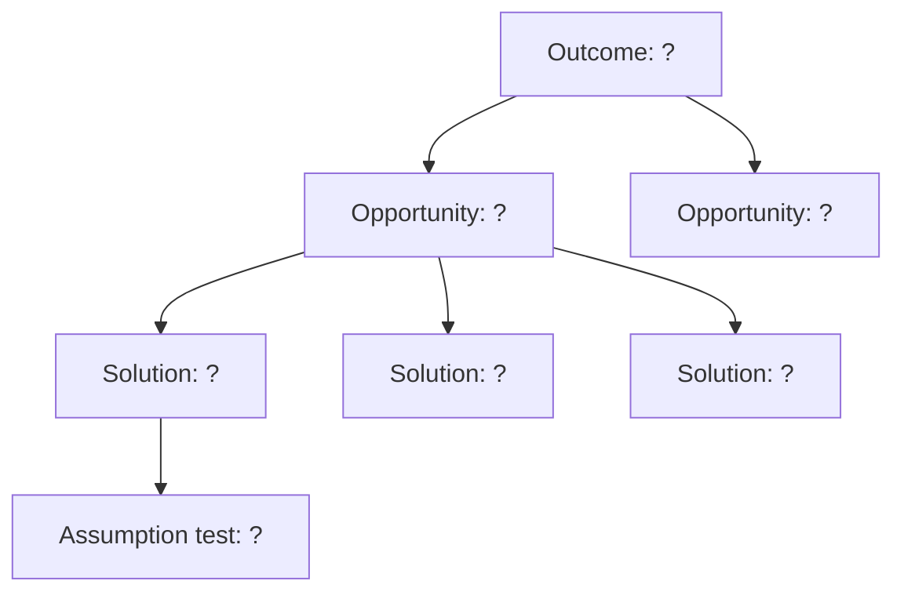

# Opportunity solution tree — <product>

> Maintained by the `discovery` skill. Outcome → opportunities (customer needs, pains, desires)
> → solutions (at least three per target opportunity) → assumption tests. Every opportunity links
> to evidence (FB / DS). Update after every 3–4 interviews.

- **Outcome:** ? (a product outcome the team can influence, e.g. an input metric from metrics.md)
- **Target opportunity now:** ?
- **Last updated:** YYYY-MM-DD

## Opportunities
| ID | Opportunity (customer's words) | Parent | Evidence (FB / DS, N sources) | Status (exploring / target / parked) |
|---|---|---|---|---|

## Solutions
| ID | Solution | Opportunity | Riskiest assumption (value / usability / feasibility / viability) | Test | Result |
|---|---|---|---|---|---|

## Change log
| Date | Change | Why |
|---|---|---|
